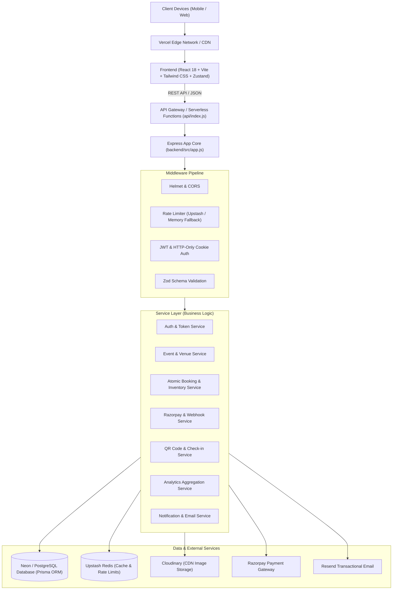
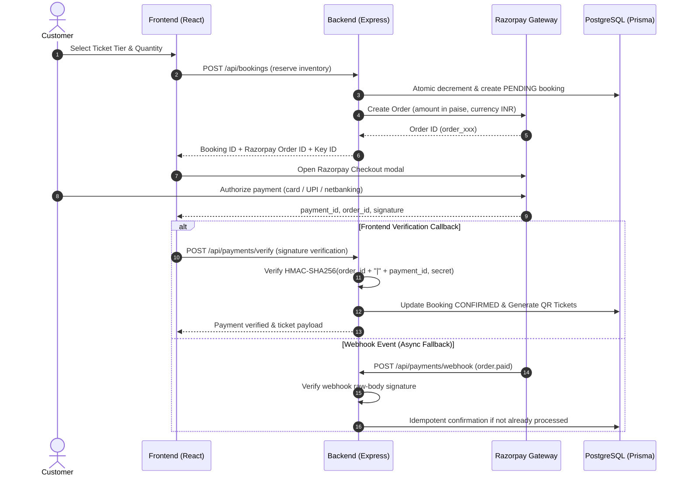

# Eventify – Architectural Specification

## 1. System Overview

Eventify is an enterprise-grade, high-concurrency event management and ticketing platform modeled after systems like BookMyShow and Eventbrite. The application is built using a modern JavaScript/ESM monorepo architecture, optimized for serverless execution on Vercel while supporting full local development against standard Node.js and PostgreSQL.



---

## 2. Monorepo Organization

```
eventify/
├── api/
│   └── index.js             # Vercel Serverless Function entry point
├── backend/
│   ├── prisma/
│   │   ├── schema.prisma    # Complete normalized PostgreSQL schema
│   │   └── seed.js          # Seed script with realistic Indian venues & events
│   ├── src/
│   │   ├── config/          # Environment, Prisma client, Redis, Razorpay, Cloudinary
│   │   ├── controllers/     # Thin HTTP controllers handling req/res
│   │   ├── middleware/      # Auth, RBAC, Rate limiter, Error handler, Upload
│   │   ├── routes/          # Express route definitions
│   │   ├── services/        # Domain business logic & transactions
│   │   ├── utils/           # Token utils, API response formatter, Logger
│   │   ├── validators/      # Zod input validation schemas
│   │   ├── app.js           # Express app instance export
│   │   └── index.js         # Local standalone HTTP server startup
│   └── package.json
├── frontend/
│   ├── src/
│   │   ├── assets/          # Static assets & brand imagery
│   │   ├── components/      # UI, forms, event cards, tickets, QR scanner
│   │   ├── context/         # Auth & Theme context providers
│   │   ├── hooks/           # Custom React hooks
│   │   ├── layouts/         # Public, Dashboard, Organizer, Admin layouts
│   │   ├── pages/           # Route views across customer, organizer, and admin
│   │   ├── services/        # Axios API client & endpoints
│   │   ├── store/           # Zustand state management
│   │   ├── utils/           # Currency, date-time formatters, helpers
│   │   ├── App.jsx          # Route declarations & query providers
│   │   └── main.jsx         # React DOM mounting
│   └── package.json
├── docs/                    # Architectural & API documentation
├── vercel.json              # Serverless routing, crons & build config
└── .env.example             # Documented environment variables
```

---

## 3. High-Concurrency Inventory Reservation Strategy

One of the most critical aspects of ticketing platforms is preventing overselling when concurrent users purchase the last remaining seats.

### The Race Condition Problem
If multiple requests read ticket availability simultaneously, both may observe `availableQuantity = 1`, and both may execute `UPDATE ... SET availableQuantity = availableQuantity - 1`, resulting in negative inventory or overselling.

### The Eventify Solution
1. **Atomic Conditional SQL Updates**:
   Inventory reservation executes an atomic PostgreSQL conditional update:
   ```sql
   UPDATE "TicketType"
   SET "availableQuantity" = "availableQuantity" - :requestedQuantity
   WHERE "id" = :ticketTypeId
     AND "availableQuantity" >= :requestedQuantity;
   ```
   If zero rows are updated, the transaction is immediately rolled back and an `INSUFFICIENT_INVENTORY` error is returned.

2. **Database Transactions**:
   The inventory reduction, booking creation with `PENDING` status, booking items creation, and expiration timestamp calculation (now + 10 minutes) happen inside a single atomic `prisma.$transaction`.

3. **Idempotency Keys**:
   Client requests pass an `Idempotency-Key` HTTP header. Repeated submissions with the same key within the reservation window return the existing reservation rather than duplicate decrementing.

4. **Safe Expiration & Inventory Release**:
   If payment is not completed before `expiresAt`, a background cron job (`/api/cron/cleanup-reservations`) or lazy check upon payment verification marks the booking as `EXPIRED` and atomically replenishes the reserved tickets exactly once.

---

## 4. Payment Workflow & Security



---

## 5. Security Architecture

1. **Authentication**: Access tokens (JWT, short-lived 15 mins) and refresh tokens (long-lived 7 days) stored hashed (SHA-256) in the database to allow immediate revocation and session management.
2. **Cookies**: HTTP-only, `SameSite=lax`, `Secure` in production to mitigate XSS and unauthorized script access.
3. **RBAC**: Server-side route authorization middleware enforcing strict role boundaries (`CUSTOMER`, `ORGANIZER`, `ADMIN`).
4. **Data Isolation**: Organizers can only inspect and manage events they own; customers can only query their own bookings and tickets.
5. **Rate Limiting**: Multi-tier rate limiting (Authentication: 5 req/min, Booking: 10 req/min, Search: 30 req/min, General: 100 req/min) utilizing Upstash Redis with a memory fallback.
