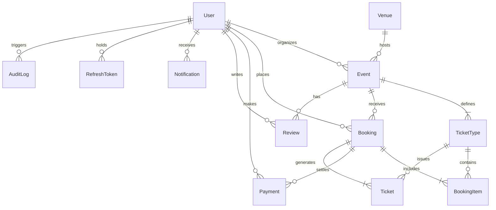

# Eventify – Database Design & Schema Specification

**ORM**: Prisma ORM  
**Engine**: PostgreSQL (Compatible with Neon Serverless & Standard PostgreSQL 16)  
**Timezone**: UTC internal storage, ISO-8601 formatting  
**Financial Types**: `@db.Decimal(10, 2)` (Strictly zero floating-point arithmetic)  

---

## 1. Entity-Relationship Diagram

---

## 2. Table Specifications & Indexes

### `User`
Stores authenticated platform identities across all roles.
- `id`: UUID (Primary Key)
- `name`: String
- `email`: String (Unique, Indexed)
- `password`: String (Bcrypt hashed, cost factor 10)
- `role`: Enum (`CUSTOMER`, `ORGANIZER`, `ADMIN`) - Default `CUSTOMER`
- `isVerified`: Boolean - Default `false`
- `avatar`: String (Optional URL)
- `phone`: String (Optional)
- `createdAt`, `updatedAt`: Timestamps

### `Venue`
Physical event locations across India.
- `id`: UUID (Primary Key)
- `name`: String
- `address`: String
- `city`: String (Indexed)
- `state`: String
- `country`: String (Default "India")
- `pincode`: String
- `capacity`: Integer
- `latitude`, `longitude`: Float (Optional)

### `Event`
Event listings managed by organizers.
- `id`: UUID (Primary Key)
- `title`: String
- `slug`: String (Unique)
- `description`: Text
- `category`: String (Indexed)
- `organizerId`: UUID (Foreign Key -> `User.id`, Cascade Delete)
- `venueId`: UUID (Foreign Key -> `Venue.id`, SetNull on delete)
- `startDate`: Timestamp
- `endDate`: Timestamp
- `imageUrl`: String (Cloudinary URL)
- `status`: Enum (`DRAFT`, `PUBLISHED`, `CANCELLED`, `COMPLETED`)
- **Composite Indexes**:
  - `[status, startDate]` (Optimizes active event timeline queries)
  - `[category, status]` (Optimizes category discovery filters)
  - `[organizerId]` (Optimizes organizer portfolio lookups)

### `TicketType`
Available tiers for an event (e.g. VIP, General, Early Bird).
- `id`: UUID (Primary Key)
- `eventId`: UUID (Foreign Key -> `Event.id`, Cascade Delete)
- `name`: String
- `description`: String (Optional)
- `price`: Decimal(10, 2)
- `totalQuantity`: Integer
- `availableQuantity`: Integer (Decremented conditionally during atomic reservation)
- `salesStart`, `salesEnd`: Timestamps
- `maxPerOrder`: Integer (Default 5)
- **Composite Indexes**:
  - `[eventId, availableQuantity]` (Optimizes real-time capacity checks)

### `Booking`
A customer reservation or confirmed purchase.
- `id`: UUID (Primary Key)
- `userId`: UUID (Foreign Key -> `User.id`)
- `eventId`: UUID (Foreign Key -> `Event.id`)
- `totalAmount`: Decimal(10, 2)
- `status`: Enum (`PENDING`, `CONFIRMED`, `EXPIRED`, `CANCELLED`, `FAILED`)
- `expiresAt`: Timestamp (Reservation lock timestamp, 10 min hold)
- `idempotencyKey`: String (Unique, Indexed; prevents duplicate booking orders)
- **Composite Indexes**:
  - `[userId, status]`
  - `[eventId, status]`
  - `[expiresAt, status]` (Optimizes background reservation cleanup jobs)

### `BookingItem`
Line items of ticket types and quantities within a booking.
- `id`: UUID (Primary Key)
- `bookingId`: UUID (Foreign Key -> `Booking.id`, Cascade Delete)
- `ticketTypeId`: UUID (Foreign Key -> `TicketType.id`, Restrict Delete)
- `quantity`: Integer
- `unitPrice`: Decimal(10, 2)
- `subtotal`: Decimal(10, 2)

### `Payment`
Payment transaction records with external gateway metadata.
- `id`: UUID (Primary Key)
- `bookingId`: UUID (Foreign Key -> `Booking.id`)
- `userId`: UUID (Foreign Key -> `User.id`)
- `amount`: Decimal(10, 2)
- `provider`: String (Default "RAZORPAY")
- `providerOrderId`: String (Indexed)
- `providerPaymentId`: String (Optional)
- `status`: Enum (`PENDING`, `SUCCESS`, `FAILED`, `REFUNDED`)

### `Ticket`
Individual verifiable digital admission passes generated upon payment.
- `id`: UUID (Primary Key)
- `bookingId`: UUID (Foreign Key -> `Booking.id`)
- `ticketTypeId`: UUID (Foreign Key -> `TicketType.id`)
- `ticketCode`: String (Unique, format `EVT-XXXX-YYYY`)
- `qrCode`: Text (Base64 PNG Data URL)
- `status`: Enum (`VALID`, `USED`, `CANCELLED`)
- `checkedInAt`: Timestamp (Recorded upon gate QR scan)
- **Composite Indexes**:
  - `[bookingId]`
  - `[ticketCode]`
  - `[status]`

### `Review`
Attendee ratings and comments.
- `id`: UUID (Primary Key)
- `eventId`: UUID (Foreign Key -> `Event.id`)
- `userId`: UUID (Foreign Key -> `User.id`)
- `rating`: Integer (1 to 5)
- `comment`: Text (Optional)
- **Constraints**:
  - `@@unique([eventId, userId])`: Strictly enforces 1 review per attendee per event

### `AuditLog`
Immutable administrative audit log.
- `id`: UUID (Primary Key)
- `userId`: UUID (Optional Foreign Key -> `User.id`, SetNull)
- `action`: String (e.g. `USER_ROLE_UPDATED`, `EVENT_STATUS_MODERATED`)
- `entityType`: String (`USER`, `EVENT`, `BOOKING`)
- `entityId`: String (Optional)
- `metadata`: JSON
- `createdAt`: Timestamp
